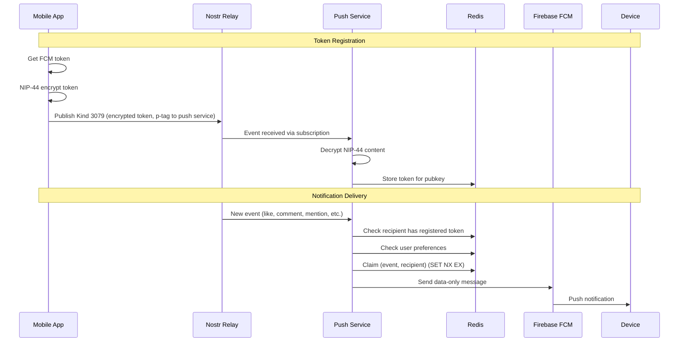

# Developer Guide

## Architecture Overview

divine-push-service is a single-app Nostr push notification service. It connects to Nostr relays, watches for events that should trigger notifications, and delivers them via Firebase Cloud Messaging (FCM).



## Event Kinds

| Kind | Direction | Purpose |
|------|-----------|---------|
| 3079 | Client → Relay → Service | Register FCM push token (NIP-44 encrypted) |
| 3080 | Client → Relay → Service | Deregister push token (NIP-44 encrypted) |
| 3083 | Client → Relay → Service | Update notification preferences (optional) |
| 30000 | Client → Relay → Service | NIP-51 people list; `d=notify` carries new-post ("bell") subscriptions. Public and unencrypted, and addressed to the world rather than `p`-tagged to the service |

See [NIP-XX Push Notifications](nip-xx-push-notifications.md) for the full protocol specification.

## Notification Types

The service supports these notification types. Direct messages enter through an
authenticated internal hook; all other rows are watched in production config.

| Type | Event Kind | Trigger |
|------|-----------|---------|
| Like | 7 | Reaction to user's note (p-tag) |
| Comment | 1111 | NIP-22 comment on a user's video or article (notifies root author `P` and parent author `p`) |
| Mention | 30023 | Long-form content mentioning user (p-tag) |
| Mention | 34236 | Addressable video tagging user (p-tag) |
| Repost | 16 | Repost of user's note (p-tag) |
| DirectMessage | 1059 | Triggered only by the authenticated internal hook. The relay listener deliberately does not ingest gift wraps because a raw wrap does not reveal whether it is chat, a sender self-copy, a reaction, or a file message |
| NewPost | 34236 | A creator the user belled published a video. The only type whose recipients do not come from a `p` tag — see [New-post subscriptions](#new-post-subscriptions-bells) |
| activityDigest | 7, 16 | One push summarizing buffered likes and reposts across posts; replaces per-event Like and Repost pushes by default — see [Like and Repost coalescing](#like-and-repost-coalescing) |

> **Note:** Divine video comments are NIP-22 `kind:1111`, not `kind:1`. They notify both the **root author** (uppercase `P` — the video owner, so they hear about comments on their video) and the **direct parent author** (lowercase `p` — for a reply, the parent comment's author). The two coincide for a top-level comment and are deduplicated. Every such push carries the authoritative root-video coordinate (see [Routing & attribution contract](#routing--attribution-contract)), so a reply to someone else's comment still routes to the correct video instead of a guessed one. The service does not subscribe to kind-1 text notes because Divine does not surface them in the notification Inbox.

## FCM Payload Format

The FCM message carries **no top-level `notification` field**. The `data` map
below is always present and every value is a string. Direct-message payloads are
the privacy-preserving exception to the social-notification shape: they omit
`senderPubkey`, `senderName`, `timestamp`, and all `referenced*` fields because a
gift wrap reveals no real sender or inner event. Per-platform delivery then
diverges so that **one incoming push produces exactly one visible banner**:

- **Android** — data-only (top-level `notification` unset) with `android.priority` set to `high`. Android does not auto-display data messages, so the app renders the single banner itself from the `data` fields; high priority lets FCM wake an idle device promptly for this user-visible notification.
- **iOS** — the service attaches an APNS override: `aps.alert` (title/body) + `mutable-content: 1`, push-type `alert`, priority 10. The OS presents the single banner; a Notification Service Extension (if shipped) uses `mutable-content` to *enrich* that same banner, never to create a second one. `content-available` is deliberately omitted — see [Avoiding duplicate banners](#avoiding-duplicate-banners).

```json
{
  "data": {
    "type": "like",
    "eventId": "abc123...",
    "title": "New like",
    "body": "Alice liked your post",
    "senderPubkey": "def456...",
    "senderName": "Alice",
    "receiverPubkey": "789abc...",
    "receiverNpub": "npub1...",
    "eventKind": "7",
    "timestamp": "1712345678",
    "referencedEventId": "fedcba...",
    "referencedAddress": "34236:9b2f...:my-vine-id",
    "referencedKind": "34236",
    "referencedAuthorPubkey": "9b2f...",
    "referencedDTag": "my-vine-id"
  }
}
```

### Routing & attribution contract

Each field is either **authoritative** — the client may route to and attribute the notification from it directly — or **presentation-only** — safe to display, but never used to decide *which* target to open.

For a like, comment, or repost on a video the authoritative target is the addressable coordinate in `referencedAddress` (`kind:pubkey:d-tag`), taken verbatim from the triggering event's `a`/`A` tag. The owner pubkey is therefore the one the actor signed into the event, not the notification recipient.

For a kind 34236 video mention, the triggering event is itself the addressable target. Its `referencedEventId` is the video's event id, while `referencedAddress` and its component fields come from the video's own kind, author pubkey, and `d` tag.

> **Clients MUST NOT** synthesize a video coordinate by pairing `referencedDTag` (or any d-tag) with the *recipient's* pubkey. The recipient is not necessarily the video owner — e.g. a reply to another user's comment, or a mention — and doing so attributes the notification to the wrong (or a nonexistent) video. Use `referencedAuthorPubkey` / `referencedAddress` for ownership; fall back to `referencedEventId` when no coordinate is present.

When the triggering event is not addressable and carries no addressable reference (a mention in a plain note or a like on a comment), the `referenced*` video fields are omitted and the client falls back to `referencedEventId`, then to the actor's profile.

#### Authoritative (routing / attribution)

| Field | Type | Description |
|-------|------|-------------|
| `type` | string | `like`, `comment`, `mention`, `repost`, `directMessage`, `newPost`, or `activityDigest`. Match the exact camelCase strings. An `activityDigest` has no sender, `eventKind`, or referenced-target fields, its `eventId` is the first buffered trigger, and a tap should open the notification inbox |
| `eventId` | hex | The Nostr event that triggered the notification (the like/comment/mention/repost/video event itself); stable id for dedup and a routing fallback |
| `senderPubkey` | hex | (omitted for `directMessage`) Pubkey of the actor who triggered the event; routes otherwise-unresolved taps |
| `receiverPubkey` | hex | Pubkey of the notification recipient |
| `referencedEventId` | hex | (optional) Target event. For a direct kind 34236 trigger this is the video event's own id. Otherwise it is root-aware: the NIP-22 uppercase `E` root scope when present, else the lowercase `e` tag — so comments anchor to the root video, not the parent comment |
| `referencedAddress` | string | (optional) Authoritative addressable target coordinate `kind:pubkey:d-tag`. Built from a direct kind 34236 trigger's own identity, or taken from the event's `A` (NIP-22 root) or `a` tag for an indirect reference |
| `referencedKind` | string | (optional) Kind component of `referencedAddress` (e.g. `34236`) |
| `referencedAuthorPubkey` | hex | (optional) Owner-pubkey component of `referencedAddress` — the authoritative video owner |
| `referencedDTag` | string | (optional) `d`-tag component of `referencedAddress`. Combine only with `referencedAuthorPubkey` (never the recipient) to rebuild the coordinate |

#### Presentation-only (display)

| Field | Type | Description |
|-------|------|-------------|
| `title` | string | Human-readable title (e.g. "New like") |
| `body` | string | Human-readable body (e.g. "Alice liked your post") |
| `senderName` | string | (omitted for `directMessage`) Display name or truncated npub of the sender |
| `receiverNpub` | bech32 | Bech32-encoded npub of the recipient |
| `eventKind` | string | Triggering Nostr event kind as a string (e.g. "7") |
| `timestamp` | string | (omitted for `directMessage`) Unix timestamp of the triggering event as a string |

### Internal direct-message hook

DM pushes bypass the nonurgent two-push allowance and six-hour gap. They retain
preferences, presence, timezone/quiet-hour checks, replay deduplication and visit
fencing, and share the five-per-hour/twenty-per-day guardrails with other pushes.

Trusted senders request a generic direct-message push with
`POST /internal/v1/direct-message` and the bearer token configured through
`NOSTR_PUSH__SERVER__INTERNAL_API_TOKEN`. The endpoint is unavailable when the
token is unset.

```json
{
  "eventId": "<gift-wrap event id>",
  "recipientPubkey": "<recipient hex pubkey>",
  "messageType": "moderation_notice"
}
```

`messageType` accepts `moderation_notice` and `report_outcome`. This explicit
classification is the reason the hook can trigger a message push while the raw
kind-1059 relay stream cannot. The event id supplies replay deduplication; none
of the request fields add sender or content metadata to the FCM payload.

This initial contract covers automated moderation notices and report outcomes.
Manual moderator replies and automated community warnings remain outside the
classified hook until their message classes are added to both services.

Both message types require explicit account opt-in and a capable device.
The recipient's stored kind-3083 preference list must include kind `1059`. Each receiving
device must advertise the boolean `"directMessageRouting": true` in its
encrypted kind-3079 registration alongside `token`. The service checks both
before claiming delivery and again before reserving a notification slot.
Absent or unreadable preferences suppress delivery, including when the server
defaults contain 1059. A device that omits the capability stays silent even when
another device for the same account can receive the alert.

Deploy the service gate before releasing the mobile DM setting. A capable
mobile upgrade must register again even when its FCM token is unchanged.
Publish 1059 only after explicit opt-in. If a legacy client later publishes a
kind list without 1059, alerts stop on every device until an opted-in client
restores the preference. Signing out removes the device registration; a new
owner must register their own capability and have their own consent. Replaying
older preferences from a relay preserves the account’s latest signed choice.
Equal timestamps prefer the lower event ID.

A `204` means the request was processed, not that FCM reached a device. Missing
tokens, disabled preferences, an existing delivery claim, and terminal FCM
failures are successful no-op outcomes under the existing delivery contract.
An all-token retryable FCM failure releases the claim and returns `5xx`, but the
moderation caller is deliberately best-effort and does not retry; push failure
must never delay or fail the moderation action. The endpoint waits for delivery
before responding, and one FCM operation can take up to 45 seconds (plus Redis
work). The moderation service must therefore dispatch this request outside the
moderation action's critical path or enforce a short caller-side timeout; it
must not await the endpoint without an independent bound.

The `referenced*` coordinate fields are emitted when the triggering event is a kind 34236 addressable video, or when it references an addressable event via `a`/`A` — currently videos referenced by likes, reposts, and NIP-22 comments (kind 1111). Likes/reposts/comments on non-addressable targets and long-form mentions omit them.

### iOS APNS shape

For a like, the APNS override the service emits is:

```json
{
  "aps": {
    "alert": { "title": "New like", "body": "Alice liked your post" },
    "mutable-content": 1
  },
  "type": "like",
  "eventId": "abc123...",
  "...": "remaining data fields (title/body live in aps.alert, not duplicated here)"
}
```

Headers: `apns-push-type: alert`, `apns-priority: 10`.

A *silent/background* push — a data message with neither `title` nor `body` — instead uses `aps.content-available: 1`, push-type `background`, priority 5. The current notification types always carry `title`/`body`, so this background shape is not emitted today.

### iOS Live Activity shape

Live Activity updates are not notifications. They go to Firebase as a message with
no `notification` and no `data`, addressed to the activity rather than the app
(`live_activity_body` in `src/fcm_sender.rs`):

```json
{
  "token": "<fcm-token>",
  "apns": {
    "live_activity_token": "<activityPushToken>",
    "headers": {
      "apns-priority": "5",
      "apns-expiration": "<stale-date>"
    },
    "payload": {
      "aps": {
        "timestamp": 1800000180,
        "event": "update",
        "content-state": {
          "phase": "live",
          "views": 12,
          "likes": 3,
          "comments": null,
          "updatedAt": 1800000180,
          "showFirstRunNote": false,
          "postCoordinate": "34236:<author-pubkey-hex>:<d-tag>",
          "postEventId": "<64 hex event id>"
        },
        "stale-date": 1800000780
      }
    }
  }
}
```

- `event` is `update` (`apns-priority` `5`) or `end` (`apns-priority` `10`). An `end`
  also carries `aps.dismissal-date`. A summary or "can't find" end uses the send
  time + 1800 s; an end sent after stats stayed unreachable past the window uses a
  time just before the send, so the frozen numbers leave the Lock Screen at once.
- `stale-date` is the send time + 600 s, and an update's `apns-expiration` carries
  the same value as a string, so APNs drops a late update rather than delivering it
  stale. An `end` has no `apns-expiration`: the activity is finished once Firebase
  accepts it, so APNs must keep it until a phone that was offline reconnects.
- `content-state` keys are a contract with the app: `phase` (`posting`, `live`,
  `notFound` or `summary`), `views`, `likes`, `comments` (integer or `null` when
  unknown), `updatedAt`, `showFirstRunNote`, `postCoordinate`, and `postEventId`
  (the first of the registered `postEventIds`). `updatedAt` is Unix seconds as an
  integer, and the widget decodes it that way. Every content state echoes
  `postCoordinate`, `postEventId` and `showFirstRunNote`.
- Counts come from `POST /api/videos/stats/bulk` on `live_activity.funnelcake_base_url`
  (`views` to `views`, `reactions` to `likes`, `comments` to `comments`), taking each
  counter's maximum across an edited post's ids. When at least one of the post's ids
  is present and every present id reports `views: null`, the worker falls back to
  `GET /api/videos/{id}/views` for the first id, within the per-replica
  `views_lookups_per_minute` budget; when the budget is spent it reuses the last
  sent views. A rate-limited fallback also reuses them, and no further fallback is
  made until its `Retry-After` (60 s when absent, at most a cadence) has passed. A
  fallback that the tick's deadline cuts short or keeps from starting reuses them
  too, though one cut short still counts as `failed` in the lookup metric. Any
  other failed request or fallback skips the cycle.
- Before the settle point (`max(postedAt, first_seen_at)` + 600 s) a 0 count is sent
  as `null`; from then on a 0 is a confirmed 0. From the settle point, a post none of
  whose ids is found in two consecutive successful checks ends with phase `notFound`.
  A miss counts once the update showing it has been sent, so the two checks are at
  least a cadence apart even when a send fails and is retried sooner.
  At `windowEndsAt` the activity ends with phase `summary`. If stats stay unreachable
  until `windowEndsAt` + 600 s, it ends on the last content sent.
- The worker never prunes `user_tokens:*` or `token_to_pubkey`, even when Firebase
  reports the token unregistered; it only finishes the activity, and only on the
  second dead-token answer in a row for the same Firebase token. The first answer
  records the token's hash (`dead_fcm_hash`) and retries a cadence later (never
  past the outage grace), so a 3079 with a refreshed token that arrives just after
  the answer keeps the card updating. A delivered update for that token, or a 3079
  with another token, clears the marker, so the next dead-token answer counts as a
  first answer again.
  Logs carry full event ids and pubkeys and an 8-character `token_prefix` for FCM
  and activity tokens, never a whole token.

### Live Activity metrics

All use the shared `push_` prefix and are separate from the `fcm_send_*` metrics.

| Metric | Labels | Meaning |
|--------|--------|---------|
| `push_live_activity_registrations_total` | `outcome`: `created`, `updated`, `superseded`, `stale`, `tombstoned`, `over_owner_cap`, `over_total_cap`, `token_owned_elsewhere`, `ended`, `tombstoned_unseen`, `disabled`, `expired`, `invalid`, `out_of_window` | Handling of each Live Activity 3079 |
| `push_live_activity_sends_total` | `event` (`update`, `end`), `result` (`ok`, or the Firebase failure reason such as `token_not_registered`, `retryable_internal`) | Firebase sends |
| `push_live_activity_stats_failures_total` | `reason`: `request`, `status`, `rate_limited`, `decode` | Failed Funnelcake stats or views requests |
| `push_live_activity_skipped_total` | `reason`: `stats_failed`, `views_failed`, `store_failed`, `tick_failed`, `tick_panicked`, `panicked` | Cycles that sent nothing |
| `push_live_activity_views_lookups_total` | `result`: `ok`, `failed`, `budget_spent` | `/views` fallback lookups |
| `push_live_activity_active` | none (gauge) | Active activities, read from `ZCARD live_activity_jobs`, so identical on every replica |
| `push_live_activity_oldest_due_age_seconds` | none (gauge) | Age of the oldest overdue activity (compare `push_coalesce_oldest_due_age_seconds`). Written by the worker, so it freezes rather than rises when the worker stalls |
| `push_live_activity_last_tick_unix` | none (gauge) | Unix seconds of this replica's last finished worker pass, whatever its outcome. The stall signal: alert when it stops advancing while `live_activity.enabled` is on |

### Avoiding duplicate banners

`content-available: 1` is intentionally **absent** from alert pushes. It is iOS's background-update flag: it wakes the app's background isolate, which would build a **second, local** banner on top of the OS-presented `aps.alert` — the duplicate-banner bug ([divine-push-service#20](https://github.com/divinevideo/divine-push-service/issues/20)). An `aps.alert` push is delivered reliably to **terminated** iOS apps *without* `content-available` (that flag matters only for *silent* pushes, which iOS throttles when the app is terminated), so omitting it costs no delivery reliability.

The contract is mirrored on the client ([divine-mobile#4760](https://github.com/divinevideo/divine-mobile/pull/4760)): the app renders a local banner **only** when the message has no OS-presented notification (`message.notification == null`, i.e. the Android data-only case). When iOS surfaces the `aps.alert` as `RemoteMessage.notification`, the client suppresses its local render. Result: **one push → one banner** across foreground, background, and terminated states.

### Client Handling

- **Android**: data-only — the app creates and displays the notification via `onMessageReceived` / background handler.
- **iOS**: the OS presents the `aps.alert`; an optional Notification Service Extension enriches it via `mutable-content`. The app must **not** create a separate local notification for these.
- **Foreground**: iOS does not OS-present in the foreground, so the app is the sole renderer; Android likewise renders once.
- **Taps**: tapping the OS-presented banner routes via the platform notification-open callbacks (e.g. `onMessageOpenedApp` / `getInitialMessage`) using the `data` fields; routing does not depend on `content-available`.

## Service Discovery

The push service exposes its public key via the `/health` endpoint:

```
GET /health
```

```json
{
  "status": "ok",
  "pubkey": "abc123...",
  "tasks": { "nostr_listener": true, "event_handler": true, "new_post_fanout": true, "coalesce_flush": true }
}
```

Clients use this pubkey to:
- Set the `p` tag on Kind 3079/3080/3083 events
- Encrypt the NIP-44 content to the service's key

The same endpoint is both Kubernetes probes. It returns `503` with
`"status": "degraded"` when the Nostr listener, event handler, durable
new-post fan-out worker, or coalescing flush worker has died,
so a pod that can no longer deliver is restarted instead of staying in service.
The `pubkey` field is present either way.

## Like and Repost coalescing

One popular post must not buzz its author once per like. With the default
`coalesce_immediate_limit` of `0`, kinds 7 (Like) and 16 (Repost) buffer from
the first interaction into one account digest per recipient, visit generation,
and `coalesce_window_secs` bucket (two hours by default), across all posts and
both types. The flush sends one data-only `activityDigest` push ("You received
3 likes and 2 reposts.") with no actor or target; a tap opens the notification
inbox. One actor's repeated like or repost of the same target counts once, and
each category stops counting exactly at 1024 ("at least 1024 likes"). The
digest is subject to the shared visit policy in
[`notification-delivery.md`](notification-delivery.md) instead of the
per-recipient token bucket and emission window below. A like or repost without
an event reference or addressable coordinate is not pushed at all.

A positive `coalesce_immediate_limit` restores the legacy per-post behavior,
coalescing per `(recipient, type, target)` inside the same buckets:

- The first `coalesce_immediate_limit` interactions in a bucket send
  immediately, with today's copy.
- The rest collect in a bucket group and flush at the bucket deadline as one
  summary: "alice and 12 others liked your post". The count is the distinct
  actor count from a HyperLogLog; the named actor is the first buffered one,
  resolved at flush time.
- A per-recipient token bucket (capacity `recipient_throttle_capacity`,
  refilling one token per `recipient_throttle_refill_secs`) demotes a
  would-be-immediate push into the bucket instead of dropping it.
- A rolling emission window holds each recipient to `recipient_daily_cap`
  emitted like/repost notifications (immediates and summaries) per
  `recipient_daily_window_secs`. At the cap, immediate pushes buffer and
  summary flushes defer until the oldest emission ages out.
- Immediate and summary pushes for one group share an FCM collapse key derived
  from the group id: `android.collapse_key` for Android (which stays data-only)
  and the `apns-collapse-id` header for iOS. On iOS the summary replaces the
  earlier banner. On Android, FCM's collapse key only coalesces messages queued
  while the device is offline; the app renders the banners itself and does not
  key them on the collapse key yet, so a burst still shows the immediate
  banners plus the summary until the client uses it.

Comments, mentions, and new-post ("bell") notifications are deliberately not
coalesced: they have no reliably retrievable durable inbox row, so collapsing
one can lose it permanently. In legacy mode, events with neither an event
reference nor an addressable coordinate are not coalesced either, because a
summary must not mix posts in one count.

Ingest runs as one atomic Lua script that records a per-event disposition
(`i:{group}` or `b:{group}`), so a replay reproduces the original decision and
collapse id without double-counting. Bucket ids and deadlines come from the
Redis server clock. A leased outbox worker in every replica flushes claimed
groups, revalidating the allowlist, tokens, and preferences first. The full
design and its accepted losses live in
[`docs/plans/like-repost-coalescing.md`](plans/like-repost-coalescing.md).

## Deduplication

The service uses atomic Redis `SET NX EX` keys per `(event_id, recipient)` to
prevent duplicate notifications across replicas. The claim is taken only after
token, preference, coordinate, and rate-limit gates pass. A confirmed retryable
FCM failure releases that recipient's claim; any successful token retains it for
the configured processed-event TTL. This lets a replay resume recipients after
a partial failure without resending recipients that already succeeded.

Control events keep a coarse per-event claim because each mutates one
event-scoped record. Notify lists (kind 30000, `d=notify`) are idempotent through
their atomic replacement script and take no claim.

## User Preferences

Users can optionally send a Kind 3083 event to control which notification types they receive. The decrypted content is:

```json
{ "kinds": [1, 7, 16], "campaignsEnabled": false }
```

These values are notification preference categories, not necessarily trigger event kinds. Category `1` controls comments and mentions triggered by supported kinds such as 1111, 30023, and 34236; it does not enable kind-1 text-note pushes. If no preferences are set, the service uses `[1, 7, 16, 30023, 34236]`. Kind 3 contact lists are not notification triggers in this service.

`campaignsEnabled` is separate from the event-kind categories and defaults
false when absent. Campaign delivery also requires the device UTC offset sent
in its encrypted kind-3079 registration and defers during 21:00–06:59 local
time.

## New-post subscriptions ("bells")

Every other notification type is triggered by someone acting on the recipient's
content, so recipients are read off the trigger event's `p` tags. New-post
notifications invert that: the recipient subscribed to a creator's output, and
the trigger event says nothing about who wants it.

### Source of truth

The subscription list is a public NIP-51 people list published by the client,
identified by a reserved `d` tag:

```json
{
  "kind": 30000,
  "tags": [
    ["d", "notify"],
    ["title", "Notify"],
    ["p", "<creator-pubkey-hex>"]
  ]
}
```

It is replaceable and unencrypted — the service has to be able to read it, so
there is no decryption step, unlike the kind 3079/3080/3083 control events. Any
kind 30000 arriving without exactly `d=notify` is ignored.

### Ingestion

`handle_notify_list_update` is routed **before** the control-event block and
deliberately outside its `p`-tag gate: these events are addressed to the world,
not to this service.

Two properties are load-bearing:

- **Notify lists are exempt from the replay horizon.** A list published three
  months ago and never touched since is still the user's current subscription
  set, so `is_notify_list` carves it out of the `is_event_too_old` check. The
  historical query is likewise unbounded by `since` and pages backward with
  `until`, using `notify_list_history_limit` as the per-page size valve.
  Without historical replay, a restart against a fresh Redis silently drops
  every bell until each user republishes.
- **Notify lists are idempotent without an event claim.**
  `replace_notify_subscriptions` already rejects stale list state and reapplies
  an exact replay as repair. Content events use per-recipient delivery claims,
  while registration, deregistration, and preference events retain coarse
  per-event claims.
- **An empty `p` list is legitimate**, not malformed. It means the user unbelled
  everyone, and it must clear the forward set and remove them from every reverse
  index.

`replace_notify_subscriptions` applies the diff in a single Lua script keyed on
the subscriber, because `notify_subs` and `notify_watchers` are two views of one
relation and must move together. The script re-checks the stored `created_at`
internally — a relay can deliver an older replacement after a newer one, and an
advisory check in the caller would still race.

The write order inside the script is deliberate. Redis runs a script without
interleaving anything else, but it does not roll one back, so a script that dies
partway keeps what it already wrote. Removals therefore clear the reverse index
before the forward one and additions write the forward index first, which keeps
`notify_subs` a *superset* of the true relation at every intermediate step. That
matters because `notify_subs` is the only record of which `notify_watchers:*`
keys name a subscriber, and removals are computed from it: a superset is
reconciled by the next list, while a forward index that is missing entries the
reverse index still holds cannot be repaired by anything the user can publish.
Do not "simplify" the diff back into a `DEL` and rebuild.

This covers the script failing on its own. It does not cover the index being
lost some other way, and the startup replay covers that in one direction only.
A *total* loss rebuilds: `notify_subs_ts` goes with everything else, so every
replayed list passes the guard and re-applies. A lost *reverse* index rebuilds
as well, even with `notify_subs_ts` intact, because an exact-id replay is
applied rather than rejected (see the tie-break note below) and re-asserts every
`notify_watchers:*` entry the list implies.

The mirror case is the one the replay cannot repair: if `notify_subs` is lost
while the reverse index survives, the removal loop has nothing to diff against,
so watcher entries for creators the subscriber has since unbelled stay behind
and keep delivering. Republishing does not clear them — a new list only adds —
which is the same asymmetry the write ordering above exists to avoid creating.
Removing those `notify_watchers:*` entries directly is the only lever.

Ties on `created_at` resolve by NIP-01's rule, retaining the lowest event id.
The protocol requires clients to publish the complete list on every change, so
belling two creators in quick succession produces two full-list publishes that
can share a second; resolving those by arrival order would leave this service
holding a different list than the relay does, permanently. Watch the direction
when reading the script: an equal-timestamp event is applied when its id sorts
*below* the stored one, which reads backwards from "newer wins". An exact replay
is also applied as an idempotent repair path, so startup replay can reassert
`notify_watchers:*` entries if Redis lost the reverse index while the timestamp
guard survived.

Because the script runs as one blocking unit and Redis is single-threaded, the
creator list is bounded by `notify_list_max_creators` before it reaches Redis —
otherwise one user with an absurd number of bells stalls the instance for
everyone. Excess creators are dropped with a warning rather than the whole list
being rejected, so the user keeps the bells that fit instead of losing all of
them.

Atomicity here is not theoretical: production runs more than one replica, and the
event-level claim (`try_claim_event`) only stops two replicas processing *the same*
event — it does nothing about two different list events from the same subscriber
landing concurrently. Within a single replica the handler loop is sequential, so
this is purely a cross-replica concern.

The script writes `notify_watchers:*` keys that are not declared in `KEYS`, so it
is **not Redis Cluster safe**. This deployment uses single-instance Redis; moving
to Cluster requires resharding into one call per creator slot or a hash-tagged
key layout.

### Delivery

On each incoming kind 34236, the handler sends the video's mention targets first,
then walks `notify_watchers:{author}` with paged `SSCAN` reads and bounded
delivery for each page.

**Mention wins on overlap.** A user who both watches the creator and is mentioned
in the video gets one push, typed `mention`, because that is the more specific
signal.

The rule also holds across edits, which takes an extra step because the
per-recipient coordinate record is scoped by notification type. A delivered
mention writes the `newPost` record as well as its own: naming the video already
tells the recipient it exists, which is the whole content of a bell. A delivered
bell writes only its own, since "X posted a vine" says nothing about being
mentioned. Without the one-directional carry, a watcher who was `p`-tagged in
the original and dropped from an edit would be told "posted a new vine" about a
video they were already pushed about.

Delivery is capped at one push per (subscriber, creator) per
`new_post_rate_limit_secs`. The window is opened only on a *delivered* push
(check-then-set-on-success, mirroring the video-coordinate dedup) so a failed FCM
send does not burn the user's hour. The cost is that two replicas handling
different videos from the same creator in the same instant can both pass the
check and double-send — rare, bounded, and preferable to silently eating an hour
of notifications on an FCM blip.

When the rate limit suppresses a new-post push, the video-coordinate record is
still written. That video has been intentionally dropped for that watcher, and a
later NIP-33 edit should not re-announce it as a fresh post.

New-post fan-out is durable and runs outside the event-handler loop. After inline
mention delivery, the handler atomically queues an initial Redis job containing
the video and cursor 0. A supervised worker leases one job, reads one `SSCAN`
page sized by `new_post_fanout_page_size`, and delivers with at most
`new_post_delivery_concurrency` concurrent recipient sends. Completing the page
atomically removes it and queues the next cursor. A crashed worker's page is
eligible again after `new_post_fanout_lease_secs`; recoverable failures use
exponential backoff from `new_post_fanout_retry_secs` up to five minutes, while
an FCM `Retry-After` remains a floor even when it is longer, bounded by the job's
remaining lifetime. A page is discarded after 12 total delivery attempts, which
includes about 30 minutes of scheduled default backoff. When delivery already
resolved a successor cursor, exhaustion queues that successor so one poison page
does not drop every later watcher page. The successor inherits the exhausted
page's delay so a provider-wide outage cannot immediately march through the
remaining chain;
`push_new_post_fanout_retries_total{reason,outcome}` exposes scheduled and
exhausted retries, plus ownerless preservation after a Redis operation error.
That preservation path keeps the known queue member rather than trusting a
possibly completed attempt swap, so it does not advance the durable attempt
counter. Jobs also expire after the processed-event TTL. Graceful
shutdown releases the active page immediately; a crash relies on lease expiry.
Successful per-recipient claims make these at-least-once page retries safe. The
page size is not a recipient cap; jobs continue until Redis returns cursor 0.
Operators tuning page size or delivery concurrency should retain a lease of at
least `ceil(page_size / concurrency) * 45 seconds`, plus headroom for Redis and
profile work. The shipped defaults use 900 seconds for the FCM ceiling and five
minutes of headroom.

The rate limit is push-only. The in-app feed shows every post from belled
creators, so a user who receives one push for a six-post burst opens the app and
sees all six. That is intended.

### Subscription retention on deregistration

Nothing removes a subscriber. `notify_subs:*`, `notify_subs_ts:*` and
`notify_watchers:*` carry no TTL, `handle_deregistration` does not touch them,
and the cleanup service does not sweep them. A user who deregisters their push
token leaves their bell subscriptions in place indefinitely.

This is accepted for now, not overlooked:

- It is not a data-exposure question. The bell list is a kind 30000 `d=notify`
  event and deliberately unencrypted, so it is already public on relays; the
  reverse index holds nothing the relay does not.
- It sends nothing. A deregistered user has no tokens, so
  `send_notification_to_user` returns before any push.
- The real cost is wasted fan-out iteration: those pubkeys stay in
  `notify_watchers:{creator}` and are read, paged and gated on every video from
  a creator they will never hear from.

The obvious fix has a trap, which is why it is not a one-line addition to
`handle_deregistration`. Deleting the subscriptions on deregistration means they
do not come back when the same user re-registers, because the historical
notify-list replay that would rebuild them runs only at startup. Deregistration
cleanup therefore belongs with rebuild-on-registration, and both are tracked in
the fan-out follow-up rather than done by halves here.

## Redis Keys

The canonical registration and removal rules live in the push specification's
[Token lifecycle](nip-xx-push-notifications.md#token-lifecycle) section.

| Key Pattern | Type | Description |
|-------------|------|-------------|
| `user_tokens:{pubkey}` | Set | FCM tokens registered for a pubkey |
| `token_to_pubkey` | Hash | Reverse mapping from token to owner pubkey |
| `stale_tokens` | Sorted Set | Last time each token was known good, for cleanup. Scored at registration and refreshed on every delivered push, so the sweep deletes devices that have gone quiet rather than devices that merely registered a long time ago. The refresh is `ZADD XX GT`: `XX` never re-creates a token deregistered between the send and the refresh, `GT` never lowers a score |
| `dedup:{event_id}` | String | Per-event processing claim with TTL for registration, deregistration, and preference control events. Not taken for notify lists, which are idempotent by `created_at` and would be lost for the TTL if a failed handler left a claim standing |
| `dedup:{event_id}:{recipient}` | String | Per-recipient content-delivery claim with TTL. Acquired before FCM, retained after any successful or ambiguous delivery, and released after confirmed retryable failure |
| `dedup:34236:{type}:{owner}:{d-tag}:{recipient}` | String | Per-recipient video delivery decision, retained for the configured coordinate TTL (one year by default). `{type}` is the notification type (`newPost`, `mention`), so a bell and a mention for the same video coordinate keep independent records. A delivered mention writes both records, since naming the video already tells the recipient it exists; a delivered or rate-limited bell writes its own |
| `fanout:enqueued:{event_id}` | String | Initial new-post fan-out enqueue marker with the processed-event TTL |
| `new_post_fanout_jobs` | Sorted Set | Durable new-post page jobs. The score is the next availability time or active lease deadline |
| `user_preferences:{pubkey}` | String | JSON notification preferences |
| `notify_subs:{subscriber}` | Set | Creators this user has belled. Diffed against each incoming replacement list. |
| `notify_subs_ts:{subscriber}` | String | `created_at:event_id` of the last applied notify list. Guards against out-of-order relay delivery of a replaceable event, and carries the id so a `created_at` tie resolves by NIP-01's lowest-id rule. Exact-id replays apply idempotently for repair. A bare integer written by an earlier build is read as a timestamp with no known id, which only makes the guard more conservative. |
| `notify_watchers:{creator}` | Set | Subscribers watching this creator. The hot read path walks this set with paged `SSCAN` reads. |
| `notify_rate:{subscriber}:{creator}` | String | New-post rate-limit window marker, TTL `new_post_rate_limit_secs` (one hour by default). |
| `coalesce:g:{type}:{owner}:{target}:{bucket}` | Hash | One bucket's like/repost group: deadline, pending and immediate counts, first buffered actor/event, latest timestamp, routing reference fields, and the current flush lease token. TTL `coalesce_window_secs + coalesce_logical_expiry_grace_secs` |
| `coalesce:g:activity:{owner}:{generation}:{bucket}` | Hash | One account digest: deadline, `generation`, `likes`/`reposts` counts and their `_lower_bound` flags, up to 1024 hashed action identities per category, first event, latest timestamp, and the flush lease token. Its dispositions live as long as the group, because a cooldown can hold it past its bucket |
| `coalesce:hll:{type}:{owner}:{target}:{bucket}` | HyperLogLog | Distinct buffered actors for the group. Same TTL as the group |
| `coalesce:disp:{event_id}:{recipient}` | String | Per-event ingest disposition, `i:{group}` (immediate) or `b:{group}` (buffered), so a replay reproduces the original decision and collapse id. Same TTL as the group |
| `coalesce:due` | Sorted Set | Bucket groups due for flush, scored by deadline. `{target}` is `e:{event-id}` or `a:{kind:pubkey:d-tag}` |
| `coalesce:leases` | Sorted Set | Groups owned by an in-flight flush, scored by lease expiry. Reconciliation returns expired leases with pending work to `coalesce:due`, never re-adding a group with nothing pending |
| `coalesce:throttle:{owner}` | Hash | Per-recipient immediate-push token bucket (`tokens`, `ts`) |
| `coalesce:emitted:{owner}` | Sorted Set | Per-recipient rolling emission window: one member per emitted like/repost notification scored by send time, pruned to `recipient_daily_window_secs` and counted against `recipient_daily_cap` before the bucket is spent |
| `delivery_budget:{pubkey}`, `delivery_generations:{pubkey}`, `notification_activity:{pubkey}`, `notification_active:{pubkey}`, `notification_activity_session:{pubkey}:{session}`, `notification_work_generation:{pubkey}:{hash}` | Mixed | Shared interruption policy and visit state; see [notification-delivery.md](notification-delivery.md) |
| `campaign_delivery:{idempotencyKey}` | String | Campaign delivery claim. Taken for the in-flight window (`CLAIM_TTL_SECS`, 600s) while a send is running, extended to `campaign_delivery.dedup_ttl_secs` (7 days by default) once FCM accepts a push, and dropped on the outcomes that send nothing. The key being present does not by itself mean the push was delivered; a TTL beyond the in-flight window does |
| `live_activity:{blake3(owner:activityToken)}` | Hash | One iOS Live Activity, scoped by owner so one signer can never block or hijack another's activity: owner, FCM and activity tokens, post coordinate and ids, window, order stamp (`last_at` 20-digit `created_at`, `last_id`; among updates the lower id wins a same-second tie, but an `ended` wins a same-second tie against an `active`), `state`, `absent_checks`, `last_content`, `last_sent_at`, `first_seen_at`, and `dead_fcm_hash` (hash of the Firebase token after its first dead-token answer; a second answer in a row for that token finishes the activity, and a delivered update for it or a new token clears it). Expires at the first registration's `windowEndsAt` + 2100 s: updates and token rotations keep the first `postedAt`/`windowEndsAt`, so the hash and token binding can never be renewed. Ending, finishing or superseding leaves a tombstone (`state = ended`, both tokens dropped) until `windowEndsAt` + 1800 s, so a replayed `active` never restarts it. Kept apart from device registration: never touches `user_tokens:*` or `token_to_pubkey` |
| `live_activity_owner:{owner}` | Set | An owner's live activity ids, for `max_active_per_owner`. TTL extended with each member; expired or ended members are pruned when the cap is checked |
| `live_activity_device:{owner}:{blake3(fcmToken)}` | String | The device's current activity id. One active activity per owner and device; a newer one supersedes it, carrying its schedule and send state when it is the same post (an Apple token rotation) |
| `live_activity_jobs` | Sorted Set | Active activity ids scored by due time (Unix ms). A claim leases by rescoring to now + lease and drops members whose hash is gone or tombstoned. `ZCARD` is the active gauge and the `max_active_total` cap |
| `live_activity_token_owner:{blake3(activityToken)}` | String | Owner pubkey an activity token is bound to. Set by the first owner to store an activity for the token and refreshed with that activity's hash, expiring at `windowEndsAt` + 2100 s so it outlives a tombstone. Another owner's `active` for the token is refused and counted as `token_owned_elsewhere`; ends need no binding because they only ever touch the signer's own records |
